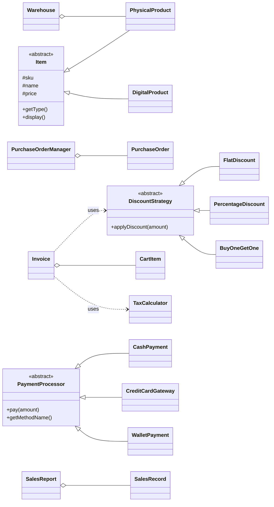
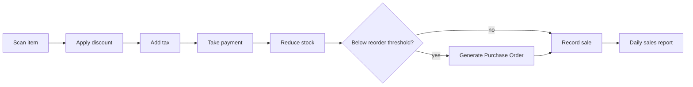
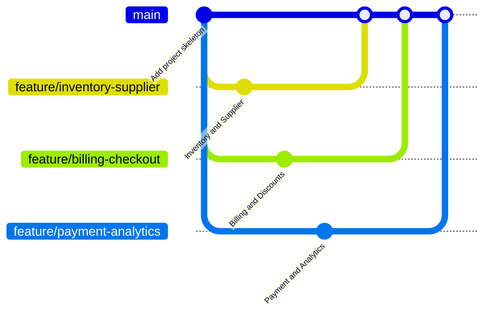

<h1 align="center">🛒 Multi-Store Inventory &amp; Point-of-Sale System</h1>

<p align="center">
  <em>A modular C++ console application for retail branches: stock tracking, checkout, payments, supplier orders and sales reports.</em>
</p>

<p align="center">
  
  
  
  
  
</p>

---

## 📖 Overview

This project simulates an **enterprise retail POS and stock-management system** that runs across several warehouse branches. It was built as an Object-Oriented Programming semester project, split into independent modules so that each team member owns one part of the system.

| | |
|---|---|
| **Language** | C++17 |
| **Interface** | Console |
| **Focus** | Encapsulation, abstraction, inheritance, polymorphism |
| **Intended users** | Cashiers, store managers, warehouse staff, suppliers |

---

## ✨ Features

| Module | What it does |
|---|---|
| 📦 **Product & Inventory Registry** | Tracks SKUs, batch numbers, stock levels, expiry dates and reorder thresholds per warehouse. Stock can never go negative. |
| 🏭 **Supplier & Purchase Orders** | Raises a Purchase Order automatically when stock drops below the reorder threshold, and restocks when the delivery arrives. |
| 🧾 **Billing & Checkout Engine** | Scans items, applies a discount strategy, calculates tax and prints the invoice. |
| 💳 **Payment Gateway** | Simulates cash, credit card and digital wallet payments with approval or decline callbacks. |
| 📊 **Sales Analytics & Reporting** | Adds up daily turnover and profit, and finds the top-selling SKU. |

---

## 👥 Team

| Role | Member | Branch | Modules |
|---|---|---|---|
| 👑 Team Lead | **Taha** | `feature/inventory-supplier` | Product & Inventory Registry, Supplier & Purchase Order |
| 🧑‍💻 Member 2 | **Ali** | `feature/billing-checkout` | Billing & Checkout Engine (discounts, tax, invoice) |
| 🧑‍💻 Member 3 | **Usman** | `feature/payment-analytics` | Payment Gateway, Sales Analytics & Reporting |

---

## 🧱 Architecture



### The planned checkout flow



---

## 🎯 OOP Concepts Used

| Pillar | Where it appears |
|---|---|
| **Encapsulation** | Stock counts are private. `reduceStock()` refuses to go below zero. |
| **Abstraction** | `PaymentProcessor` hides how each payment method works behind one `pay(amount)` call. |
| **Inheritance** | `PhysicalProduct` and `DigitalProduct` inherit from the abstract `Item` class. |
| **Polymorphism** | `DiscountStrategy::applyDiscount()` is overridden by `FlatDiscount`, `PercentageDiscount` and `BuyOneGetOne`. `pay()` is overridden by every payment class. |

---

## 📁 Project Structure

```
pos-system/
├── include/            # Header files (class declarations)
│   ├── Item.h              shared base class
│   ├── Inventory.h         PhysicalProduct, DigitalProduct, Warehouse
│   ├── Supplier.h          Supplier, PurchaseOrder, PurchaseOrderManager
│   ├── Discount.h          discount strategies
│   ├── Billing.h           TaxCalculator, CartItem, Invoice
│   ├── Payment.h           payment processors
│   └── Analytics.h         SalesRecord, SalesReport
├── src/                # Implementations (.cpp)
├── demo/               # One demo program per team member
│   ├── demo_inventory.cpp
│   ├── demo_billing.cpp
│   └── demo_payment.cpp
├── Makefile
└── README.md
```

---

## 🚀 Build and Run

You need a C++17 compiler (`g++`) and `make`.

```bash
make                # builds all three demos
./demo_inventory    # Team Lead: inventory and purchase orders
./demo_billing      # Ali: billing and discounts
./demo_payment      # Usman: payments and analytics
make clean          # removes the built programs
```

On Windows, run `demo_inventory.exe`, `demo_billing.exe` and `demo_payment.exe`.

---

## 🖥️ Sample Output

<details>
<summary><b>Inventory and purchase orders</b> (<code>./demo_inventory</code>)</summary>

```
SKU-7001 | C++ eBook | $10 | digital license
--- WAREHOUSE_NORTH ---
SKU-4992 | Wireless Mouse | $25 | stock: 6 (reorder below 5)
Sold 2. Stock now 4
Negative stock blocked
Supplier #1 | Acme Traders | acme@example.com
Auto-Trigger: stock below threshold -> PO #881 generated
PO #881 | SKU-4992 | qty 10 | Pending
After delivery, stock is 14
PO #881 | SKU-4992 | qty 10 | Delivered
```
</details>

<details>
<summary><b>Billing and discounts</b> (<code>./demo_billing</code>)</summary>

```
Scanned SKU-4992 (Wireless Mouse x2) @ $25.00 = $50.00
Applying PercentageDiscount 15%
----- INVOICE -----
SKU-4992 (Wireless Mouse x2) @ $25.00 = $50.00
Subtotal: $42.50 | Tax: $3.40 | Final Total: $45.90

Polymorphism check on $100.00:
FlatDiscount $10 -> $90.00
PercentageDiscount 15% -> $85.00
BuyOneGetOne -> $50.00
```
</details>

<details>
<summary><b>Payments and analytics</b> (<code>./demo_payment</code>)</summary>

```
Paying $45.90 by Cash
Cash payment of $45.90 accepted
-> Payment successful

Paying $45.90 by Credit Card
Payment Callback: CreditCardGateway -> APPROVED (Auth: 994821)
-> Payment successful

Paying $45.90 by Digital Wallet
Payment Callback: Wallet WALLET-77 -> APPROVED
-> Payment successful

Trying a very large card payment:
Payment Callback: CreditCardGateway -> DECLINED (**** **** **** 4417)

----- DAILY SALES REPORT -----
Daily turnover: $175.00
Gross profit:   $70.00
Top-selling SKU: SKU-1001
```
</details>

---

## 🔀 Git Workflow

| Rule | Detail |
|---|---|
| 🌿 One branch per member | Everyone works only on their own branch |
| 📝 Clear commits | Short messages describing each change |
| 🔃 Pull Requests | Each member opens a PR into `main` |
| ✅ Review and merge | The Team Lead reviews and merges |
| 🔒 Shared base | `Item.h` and `Item.cpp` belong to the Team Lead |



---

## 🗺️ Roadmap

- [x] Milestone 1: project plan, module split and class design
- [x] Milestone 1: classes and objects for every module
- [x] Milestone 1: GitHub branches, Pull Requests and merges
- [ ] Connect all modules in one `main.cpp` checkout flow
- [ ] Add input validation and error handling
- [ ] Save stock and sales data to files
- [ ] Add more discount types and a dead-stock report

---

<p align="center"><sub>Built for the Object-Oriented Programming course. Each module is the work of its own team member.</sub></p>
